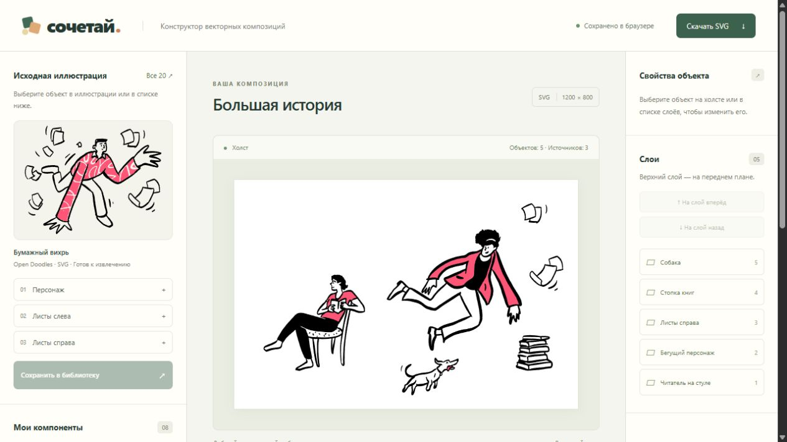
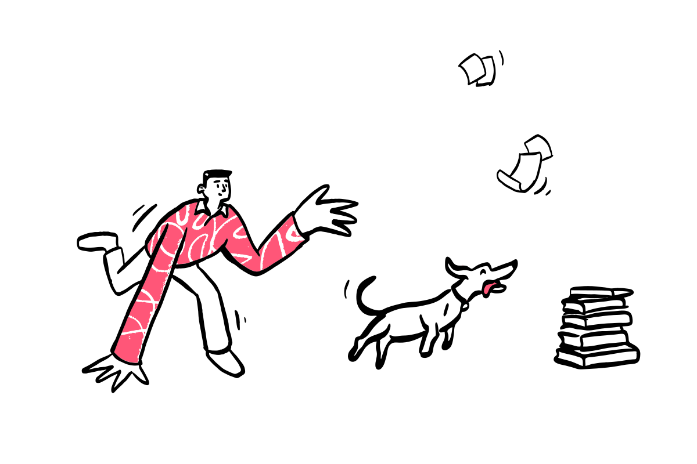

# Сочетай — конструктор векторных композиций

Браузерный MVP: извлекайте объекты из SVG-иллюстраций, сохраняйте их как
компоненты и собирайте новые композиции. Итог скачивается в SVG с отдельными
векторными объектами. Сервис ничего не генерирует.



## Запуск

Требуются Node.js 22.12+ (проверено на 24.19.0) и pnpm 11.25.0.
Visual Studio Code, сервер приложений и база данных не требуются.

```powershell
pnpm install --frozen-lockfile
pnpm dev
```

Открыть адрес, который выведет терминал: обычно http://127.0.0.1:5173.

```powershell
pnpm build
pnpm test
pnpm preview
```

`preview` открывает собранное приложение, обычно на http://127.0.0.1:4173.
Для первичной установки зависимостей нужен интернет; все SVG входят в проект.

## Возможности

- Каталог из 20 SVG одного стиля. В трёх подготовленных исходниках доступны
  9 логических компонентов: персонажи, собака, книги, бумага и линии движения.
- Выбор кликом по рисунку или через список, сохранение в библиотеку и повторное
  добавление на холст. В карточках сохраняется связь с исходником.
- Перетаскивание, координаты, равномерный масштаб, поворот вокруг центра,
  независимые копии, удаление и изменение порядка слоёв.
- Название композиции, автосохранение в этом браузере и восстановление после
  перезагрузки. При сбое хранилища можно продолжить работу и скачать SVG.
- Экспорт самостоятельного SVG 1200 × 800 с прозрачным фоном и группами объектов.
- Три готовых примера, каждый из элементов трёх разных исходников.

Клавиши: Delete / Backspace — удалить, Ctrl+D / Cmd+D — копия, стрелки —
сдвиг на 1 единицу, Shift+стрелки — на 10. При вводе в поля эти команды
не перехватываются.

### Проверка в браузере

1. Выбрать «Персонаж» в исходнике или списке.
2. Нажать «Сохранить в библиотеку».
3. Нажать карточку персонажа — он появится на холсте.
4. Через «Все 20» открыть «Вместе на пробежке» и добавить собаку тем же способом.
5. Открыть «Тихий вечер» и добавить стопку книг.
6. Переместить объекты, изменить масштаб и угол в правой панели, скачать SVG.

[Сценарий короткой демонстрации](docs/DEMO.md) ·
[Проверки](docs/VERIFICATION.md) · [Архитектура](docs/ARCHITECTURE.md)

## Примеры

Их можно открыть кнопкой «Посмотреть примеры» и изменить в редакторе.
Готовые SVG также входят в проект:

| Композиция | SVG |
| --- | --- |
| Бумажная прогулка | [Открыть](public/examples/paper-walk.svg) |
| Тихий час | [Открыть](public/examples/quiet-hour.svg) |
| Большая история | [Открыть](public/examples/big-story.svg) |



## Архитектура коротко

React + TypeScript + Vite. Нативный SVG используется и для холста, и для экспорта.
Дополнительных библиотек редактора и управления состоянием нет.

- Оригинал лежит отдельно в `public/assets/originals/`.
- Рабочая копия в `public/assets/prepared/` помечает существующие контуры
  атрибутами `data-component`. Геометрия не меняется.
- `scripts/prepare-assets.py` воспроизводит ручное распределение контуров.
  Python нужен только для повторной подготовки, не для запуска приложения.
- При извлечении сохраняются выбранные контуры и цепочки родительских групп:
  в них находятся исходные цвета и преобразования координат.
- Браузер измеряет границы SVG. Компонент получает собственную систему
  координат, размеры и ссылку на исходник.
- Экземпляры ссылаются на компонент и имеют собственные положение, масштаб
  и угол. Идентификаторы SVG получают уникальный префикс.
- В localStorage сохраняются только ссылки на известные компоненты и параметры
  сцены. SVG-фрагменты при восстановлении заново извлекаются из исходников.
- Экспорт строится из модели сцены, без интерфейсных рамок выделения.

## Ограничения MVP

- Извлечение работает на трёх подготовленных SVG; остальные 17 доступны для
  просмотра. Универсального распознавания объектов нет: ручная подготовка
  разрешена условиями задания.
- Обрабатываются только доверенные файлы проекта. Произвольная загрузка SVG,
  рисование, перекрашивание, undo/redo и совместная работа не реализованы.
- Сохраняется одна текущая сцена в рамках браузера и адреса сайта. Это не
  облачное хранилище; другой браузер или порт имеет отдельное состояние.
- Основной сценарий рассчитан на настольный браузер. Узкая раскладка проверена,
  но полноценный мобильный редактор не входит в MVP.

## Источники и AI

Иллюстрации: [Open Doodles](https://www.opendoodles.com/), Pablo Stanley.
[Условия автора](https://www.opendoodles.com/about): CC0.
Сведения обо всех исходниках — в [SOURCES.md](public/assets/SOURCES.md).

Для разработки использован OpenAI Codex: планирование, код, подготовка групп
существующих SVG-контуров и проверки. Новые иллюстрации не генерировались.
